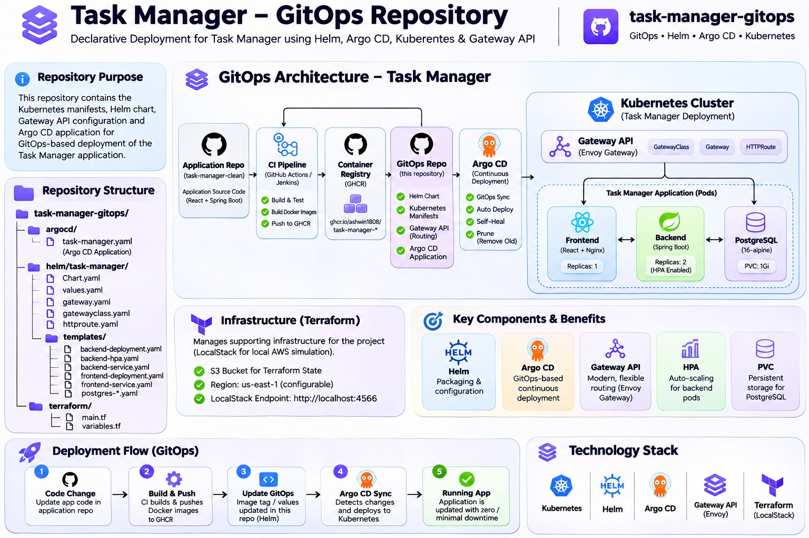

# Task Manager — GitOps & Kubernetes Deployment

A GitOps-based deployment repository for the Task Manager application, using Argo CD, Helm and Kubernetes.



## Overview

This repository contains the Kubernetes deployment configuration and infrastructure automation for the Task Manager application.

It uses Argo CD to continuously synchronize Kubernetes resources from Git, while Helm manages the application's Kubernetes manifests.

## Architecture Components

| Component | Technology | Purpose |
|---|---|---|
| GitOps | Argo CD | Automated application synchronization |
| Packaging | Helm | Kubernetes resource templating |
| Container orchestration | Kubernetes | Runs application workloads |
| Ingress and routing | Gateway API | Routes HTTP traffic |
| Gateway controller | Envoy Gateway | Implements Gateway API |
| Autoscaling | Horizontal Pod Autoscaler | Scales backend replicas |
| Persistent storage | PersistentVolumeClaim | PostgreSQL storage |
| Infrastructure automation | Terraform | S3 bucket configuration through LocalStack-compatible endpoint |

## Deployment Architecture

1. Application images are built and published to GitHub Container Registry.
2. Image references are maintained in this GitOps repository.
3. Argo CD monitors the repository's `main` branch.
4. Argo CD deploys the Helm chart into the `task-manager` namespace.
5. Kubernetes runs the frontend, backend and PostgreSQL workloads.
6. Gateway API routes `/api` traffic to the backend and `/` traffic to the frontend.

## Kubernetes Resources

### Frontend
- Deployment configured with 1 replica.
- Service exposes port 8080.
- Resource requests and limits are defined in Helm values.

### Backend
- Deployment configured with 2 replicas.
- Service exposes port 8080.
- Readiness and liveness probes use `/api/health`.
- Horizontal Pod Autoscaler configured for 2–5 replicas.
- CPU utilization target: 70%.

### PostgreSQL
- PostgreSQL 16 Alpine image.
- Database: `taskdb`.
- Service port: 5432.
- PersistentVolumeClaim configured with 1 GiB storage.

## Gateway API Routing

The HTTPRoute defines two path-based routing rules:

| Path | Destination |
|---|---|
| `/api` | task-manager-backend:8080 |
| `/` | task-manager-frontend:8080 |

The Gateway uses the Envoy Gateway controller.

The Gateway API CRDs and Envoy Gateway controller must be installed separately in the Kubernetes cluster.

## Argo CD Configuration

The Argo CD Application is defined in:

`argocd/task-manager.yaml`

Configuration:
- Repository: `task-manager-gitops`
- Branch: `main`
- Helm chart path: `helm/task-manager`
- Destination namespace: `task-manager`
- Automated synchronization enabled.
- Pruning enabled.
- Self-healing enabled.
- Namespace creation enabled.

## Helm Validation

The Helm chart was validated locally.

```bash
helm lint ./helm/task-manager
```

Render Kubernetes manifests:

```bash
helm template task-manager ./helm/task-manager --namespace task-manager
```

The chart successfully passed linting and rendered 12 Kubernetes resources.

This confirms Helm chart validation and rendering, not a live cluster deployment.

## Terraform

Terraform configuration is located in:

`terraform/`

It uses the HashiCorp AWS provider with an S3 endpoint configured at:

`http://localhost:4566`

This is intended for a LocalStack-compatible local environment.

The configuration creates an S3 bucket named:

`ashwin-task-manager-terraform-state-demo`

**Note:** The S3 bucket resource is not configured as Terraform's remote-state backend. The current Terraform state is local.

## Repository Structure

```text
task-manager-gitops/
├── argocd/
│   └── task-manager.yaml
├── docs/
│   └── images/
│       └── gitops-architecture.jpg
├── helm/
│   └── task-manager/
│       ├── Chart.yaml
│       ├── values.yaml
│       └── templates/
│           ├── backend-configmap.yaml
│           ├── backend-deployment.yaml
│           ├── backend-hpa.yaml
│           ├── backend-service.yaml
│           ├── frontend-deployment.yaml
│           ├── frontend-service.yaml
│           ├── gateway.yaml
│           ├── gatewayclass.yaml
│           ├── httproute.yaml
│           ├── postgres-deployment.yaml
│           ├── postgres-pvc.yaml
│           ├── postgres-secret.yaml
│           └── postgres-service.yaml
└── terraform/
    ├── main.tf
    ├── variables.tf
    └── .gitignore
```

## Related Repository

**Application repository:**  
https://github.com/Ashwin1808/Demo-Tasts

**GitOps repository:**  
https://github.com/Ashwin1808/task-manager-gitops

## Security Notes

- Do not commit Terraform state files.
- Replace placeholder database credentials before deployment.
- Use Kubernetes Secrets or an external secret-management solution for sensitive values.
- Keep registry credentials outside the repository.
- Review container image tags before synchronization.

## Project Status

- Helm chart linting: Passed.
- Kubernetes manifest rendering: Passed.
- Argo CD configuration: Present in repository.
- Gateway API manifests: Included in Helm templates.
- Live cluster deployment: Requires separate verification.
- Terraform: LocalStack-compatible S3 configuration.
